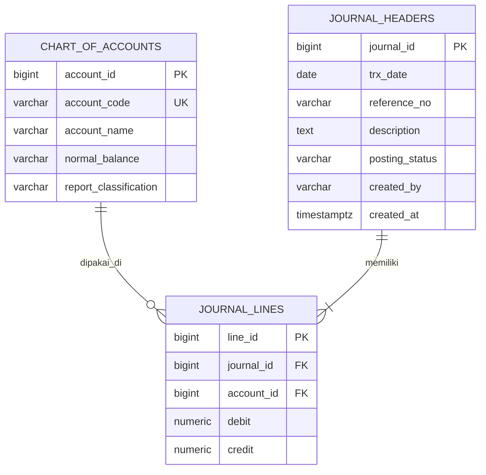

# LAPORAN UJIAN TENGAH SEMESTER — CODING AKUNTANSI

## Program Studi S1 Akuntansi
### Fakultas Ekonomika dan Bisnis — Universitas Diponegoro

| Identitas | Keterangan |
|---|---|
| Nama | **[ISI NAMA]** |
| NIM | **[ISI NIM]** |
| Kelas | **[ISI KELAS]** |
| Mata Kuliah | Pemrograman / Coding |
| Dosen Pengampu | Totok Dewayanto |
| Tanggal Ujian | 19 Oktober 2026 |
| Repositori GitHub | **[ISI LINK REPO]** |
| PDF laporan ini | **[ISI LINK PDF SETELAH EKSPOR]** |

Laporan ini mendokumentasikan rancangan basis data General Ledger, otomasi persediaan, serta purwarupa aplikasi Voucher Kas Keluar. Pembahasan menggabungkan konsep akuntansi double-entry, pengendalian integritas data pada PostgreSQL, concurrency, audit trail, dan penggunaan AI generatif secara terpandu.

**Alat bantu yang digunakan/dicatat:** NotebookLM, PostgreSQL Sandbox (Neon.tech), Gemini Canvas. Atribusi masing-masing hasil harus dicocokkan dengan riwayat penggunaan aktual pada [Lampiran A](#a-daftar-prompt-ai-yang-digunakan).

<div class="page-break"></div>

# DAFTAR ISI

1. [Soal 1 — Desain Arsitektur Data (Bobot 25%)](#soal-1--desain-arsitektur-data-bobot-25)
2. [Soal 2 — Otomasi Bisnis dan Trigger (Bobot 40%)](#soal-2--otomasi-bisnis-dan-trigger-bobot-40)
3. [Soal 3 — Web Full-Stack dan AI (Bobot 35%)](#soal-3--web-full-stack-dan-ai-bobot-35)
4. [Lampiran](#lampiran)

<div class="page-break"></div>

# SOAL 1 — DESAIN ARSITEKTUR DATA (Bobot 25%)

## 1.1 Perancangan Skema Relasional (ERD)

### a. Atribut Tiap Entitas

#### `chart_of_accounts`

| Atribut | Tipe data | Kunci/aturan | Keterangan |
|---|---|---|---|
| `account_id` | `BIGINT` | PK, identity | Identitas unik akun. |
| `account_code` | `VARCHAR(30)` | UNIQUE, NOT NULL | Kode akun. |
| `account_name` | `VARCHAR(150)` | NOT NULL | Nama akun. |
| `normal_balance` | `VARCHAR(6)` | NOT NULL, CHECK | Saldo normal `DEBIT` atau `CREDIT`. |
| `report_classification` | `VARCHAR(20)` | NOT NULL, CHECK | Klasifikasi `ASSET`, `LIABILITY`, `EQUITY`, `REVENUE`, atau `EXPENSE`. |

#### `journal_headers`

| Atribut | Tipe data | Kunci/aturan | Keterangan |
|---|---|---|---|
| `journal_id` | `BIGINT` | PK, identity | Identitas voucher/jurnal. |
| `trx_date` | `DATE` | NOT NULL | Tanggal transaksi. |
| `reference_no` | `VARCHAR(50)` | NOT NULL | Nomor bukti atau referensi voucher. |
| `description` | `TEXT` | NOT NULL | Deskripsi transaksi. |
| `posting_status` | `VARCHAR(10)` | NOT NULL, default `DRAFT`, CHECK | Status `DRAFT` atau `POSTED`. |
| `created_by` | `VARCHAR(100)` | NOT NULL | Pengguna pembuat voucher. |
| `created_at` | `TIMESTAMPTZ` | NOT NULL, default waktu saat ini | Waktu pembuatan voucher. |

#### `journal_lines`

| Atribut | Tipe data | Kunci/aturan | Keterangan |
|---|---|---|---|
| `line_id` | `BIGINT` | PK, identity | Identitas unik baris jurnal. |
| `journal_id` | `BIGINT` | FK, NOT NULL | Header voucher yang memiliki baris ini. |
| `account_id` | `BIGINT` | FK, NOT NULL | Akun yang digunakan pada baris ini. |
| `debit` | `NUMERIC(18,2)` | NOT NULL, default 0, CHECK | Nilai debit nonnegatif. |
| `credit` | `NUMERIC(18,2)` | NOT NULL, default 0, CHECK | Nilai kredit nonnegatif. |

### b. Diagram ERD (Mermaid)



*Gambar 1.1 — ERD General Ledger*

### c. Tabel Relasi

| Relasi | Kardinalitas | Penjelasan |
|---|---|---|
| `chart_of_accounts` — `journal_lines` | Satu akun ke nol atau banyak baris (`1 : 0..N`) | Akun dapat belum pernah dipakai atau dipakai pada banyak baris; setiap baris wajib menunjuk satu akun. |
| `journal_headers` — `journal_lines` | Satu header ke satu atau banyak baris (`1 : 1..N`) | Satu voucher berisi sekurang-kurangnya satu baris; setiap baris dimiliki tepat satu header. |
| `journal_headers` — `chart_of_accounts` | Banyak ke banyak melalui `journal_lines` | Sebuah voucher dapat memakai banyak akun, dan satu akun dapat muncul di banyak voucher. |

### d. Alasan Memenuhi 3NF

Dalam model header-line, atribut akun dikelola di `chart_of_accounts`, atribut transaksi disimpan di `journal_headers`, dan nominal debit/kredit serta referensi disimpan di `journal_lines`. Atribut non-key berada pada tabel yang key-nya menentukan atribut tersebut. Dengan demikian, informasi header dan akun tidak perlu disalin pada setiap baris jurnal; ketergantungan transitif dan anomali update, insert, serta delete dapat dikurangi.

## 1.2 Kekangan Integritas (DDL PostgreSQL)

DDL berikut mendefinisikan ketiga tabel, kunci, validasi nilai, komentar constraint, serta indeks yang diperlukan.

```sql
CREATE TABLE chart_of_accounts (
    account_id BIGINT GENERATED ALWAYS AS IDENTITY,
    account_code VARCHAR(30) NOT NULL,
    account_name VARCHAR(150) NOT NULL,
    normal_balance VARCHAR(6) NOT NULL,
    report_classification VARCHAR(20) NOT NULL,
    CONSTRAINT pk_chart_of_accounts
        PRIMARY KEY (account_id),
    CONSTRAINT uq_chart_of_accounts_account_code
        UNIQUE (account_code),
    CONSTRAINT ck_chart_of_accounts_normal_balance
        CHECK (normal_balance IN ('DEBIT', 'CREDIT')),
    CONSTRAINT ck_chart_of_accounts_report_classification
        CHECK (
            report_classification IN
                ('ASSET', 'LIABILITY', 'EQUITY', 'REVENUE', 'EXPENSE')
        )
);

COMMENT ON CONSTRAINT pk_chart_of_accounts ON chart_of_accounts
    IS 'Menjamin setiap akun memiliki identitas unik sebagai primary key.';
COMMENT ON CONSTRAINT uq_chart_of_accounts_account_code ON chart_of_accounts
    IS 'Mencegah kode akun yang sama digunakan lebih dari satu kali.';
COMMENT ON CONSTRAINT ck_chart_of_accounts_normal_balance ON chart_of_accounts
    IS 'Membatasi saldo normal akun ke DEBIT atau CREDIT.';
COMMENT ON CONSTRAINT ck_chart_of_accounts_report_classification
    ON chart_of_accounts
    IS 'Membatasi klasifikasi akun ke kelompok laporan keuangan yang dikenal.';

CREATE TABLE journal_headers (
    journal_id BIGINT GENERATED ALWAYS AS IDENTITY,
    trx_date DATE NOT NULL,
    reference_no VARCHAR(50) NOT NULL,
    description TEXT NOT NULL,
    posting_status VARCHAR(10) NOT NULL DEFAULT 'DRAFT',
    created_by VARCHAR(100) NOT NULL,
    created_at TIMESTAMPTZ NOT NULL DEFAULT CURRENT_TIMESTAMP,
    CONSTRAINT pk_journal_headers
        PRIMARY KEY (journal_id),
    CONSTRAINT ck_journal_headers_posting_status
        CHECK (posting_status IN ('DRAFT', 'POSTED'))
);

COMMENT ON CONSTRAINT pk_journal_headers ON journal_headers
    IS 'Menjamin setiap transaksi jurnal memiliki identitas header yang unik.';
COMMENT ON CONSTRAINT ck_journal_headers_posting_status ON journal_headers
    IS 'Memastikan status posting hanya bernilai DRAFT atau POSTED.';

CREATE TABLE journal_lines (
    line_id BIGINT GENERATED ALWAYS AS IDENTITY,
    journal_id BIGINT NOT NULL,
    account_id BIGINT NOT NULL,
    debit NUMERIC(18, 2) NOT NULL DEFAULT 0,
    credit NUMERIC(18, 2) NOT NULL DEFAULT 0,
    CONSTRAINT pk_journal_lines
        PRIMARY KEY (line_id),
    CONSTRAINT fk_journal_lines_journal
        FOREIGN KEY (journal_id)
        REFERENCES journal_headers (journal_id)
        ON DELETE RESTRICT
        ON UPDATE CASCADE,
    CONSTRAINT fk_journal_lines_account
        FOREIGN KEY (account_id)
        REFERENCES chart_of_accounts (account_id)
        ON DELETE RESTRICT
        ON UPDATE CASCADE,
    CONSTRAINT ck_journal_lines_debit_nonnegative
        CHECK (debit >= 0),
    CONSTRAINT ck_journal_lines_credit_nonnegative
        CHECK (credit >= 0),
    CONSTRAINT ck_journal_lines_not_both_zero
        CHECK (debit > 0 OR credit > 0),
    CONSTRAINT ck_journal_lines_one_side_only
        CHECK (
            (debit > 0 AND credit = 0)
            OR (credit > 0 AND debit = 0)
        )
);

COMMENT ON CONSTRAINT pk_journal_lines ON journal_lines
    IS 'Menjamin setiap baris jurnal memiliki identitas unik.';
COMMENT ON CONSTRAINT fk_journal_lines_journal ON journal_lines
    IS 'Mengaitkan baris ke header yang ada; RESTRICT menjaga audit trail.';
COMMENT ON CONSTRAINT fk_journal_lines_account ON journal_lines
    IS 'Mengaitkan baris ke akun yang ada; RESTRICT mencegah penghapusan akun terpakai.';
COMMENT ON CONSTRAINT ck_journal_lines_debit_nonnegative ON journal_lines
    IS 'Melarang nilai debit negatif.';
COMMENT ON CONSTRAINT ck_journal_lines_credit_nonnegative ON journal_lines
    IS 'Melarang nilai kredit negatif.';
COMMENT ON CONSTRAINT ck_journal_lines_not_both_zero ON journal_lines
    IS 'Memastikan debit dan kredit tidak sama-sama nol.';
COMMENT ON CONSTRAINT ck_journal_lines_one_side_only ON journal_lines
    IS 'Memastikan satu baris hanya mencatat debit atau kredit.';

CREATE INDEX idx_journal_lines_journal_id
    ON journal_lines (journal_id);
CREATE INDEX idx_journal_lines_account_id
    ON journal_lines (account_id);
CREATE INDEX idx_journal_headers_trx_date
    ON journal_headers (trx_date);
```

**Penjelasan constraint:**

- `PRIMARY KEY` mengidentifikasi baris secara unik dan menolak nilai key duplikat.
- `FOREIGN KEY` menjaga referensi antartabel. `ON DELETE RESTRICT` mencegah penghapusan akun/header yang sudah memiliki detail sehingga audit trail tidak terputus; koreksi transaksi dilakukan dengan jurnal pembalik. `ON UPDATE CASCADE` meneruskan perubahan key ke foreign key.
- `CHECK (debit >= 0)` dan `CHECK (credit >= 0)` menolak nominal negatif.
- `CHECK (debit > 0 OR credit > 0)` menolak debit dan kredit yang sama-sama nol.
- `ck_journal_lines_one_side_only` melarang debit dan kredit positif sekaligus pada satu baris.

> **Batasan integritas:** constraint di atas memvalidasi tiap baris, bukan total voucher. DDL ini belum menegakkan `SUM(debit) = SUM(credit)` pada database. Backend memeriksa keseimbangan saat posting, tetapi koneksi langsung ke database masih dapat melewatinya. Untuk integritas menyeluruh, validasi perlu ditegakkan secara atomik oleh prosedur/constraint trigger PostgreSQL dan hak akses langsung dibatasi.

> **Narasi hasil uji DDL:** PostgreSQL/Neon belum dijalankan pada sesi ini. Dengan demikian, keberhasilan eksekusi belum diklaim. Setelah dijalankan pada database uji, catat versi PostgreSQL, waktu pengujian, dan pesan hasil aktual di sini.

## 1.3 Analisis Audit dan Keamanan Finansial

### Header-Line dibandingkan Flat Table

Pada tabel flat, setiap baris debit atau kredit mengulang nomor voucher, tanggal, deskripsi, status posting, serta informasi pengguna/waktu. Pengulangan dapat menyebabkan satu voucher memiliki nomor bukti atau status yang tidak konsisten. Pada model Header-Line, satu header mewakili satu voucher, sementara detail akun dan nilai debit/kredit disimpan pada baris yang mengacu melalui foreign key.

| Aspek | Flat journal table | Model header-line |
|---|---|---|
| Identitas voucher | Diulang pada setiap baris; rentan tidak konsisten. | Satu `journal_id` menjadi identitas header; baris menunjuk melalui FK. |
| Nomor bukti | Berulang sehingga harus diperbarui pada setiap baris. | `reference_no` disimpan sekali pada header. |
| Status posting | Dapat berbeda antarbariѕ bila pembaruan tidak seragam. | Satu `posting_status` pada header mewakili status voucher. |
| Jejak user dan waktu | Metadata berulang dan dapat berbeda per baris. | `created_by` dan `created_at` dicatat sekali untuk pembuatan voucher; posting memerlukan `posted_by` dan `posted_at`. |
| Reversal/void | Relasi koreksi berulang dan mudah tidak sinkron. | Voucher baru dapat merujuk sumber melalui `reversal_of_journal_id`; voucher asal dipertahankan. |

Jurnal berstatus `POSTED` sebaiknya tidak diubah atau dihapus langsung. Kesalahan dikoreksi dengan reversal/storno agar nilai awal, koreksi, aktor, dan waktu dapat ditelusuri. Pemisahan header-line mendukung audit trail, tetapi tidak menggantikan pencatatan riwayat perubahan, kontrol akses, dan dokumentasi pendukung.

### 3NF dan anomali

Misalkan tabel flat menggunakan `line_id` sebagai primary key dan menyimpan `journal_id`, `trx_date`, `reference_no`, `description`, serta `posting_status` di setiap baris. Secara semantik, `journal_id → trx_date, reference_no, description, posting_status`. Dengan demikian, atribut header bergantung pada `line_id` melalui `journal_id` (`line_id → journal_id → atribut header`), yaitu ketergantungan transitif yang melanggar 3NF. Jika nama/klasifikasi akun turut diulang, berlaku pula `account_id → atribut akun`.

- **Anomali update:** perubahan nomor bukti atau status harus diterapkan pada semua baris; satu baris yang tertinggal menimbulkan data bertentangan.
- **Anomali insert:** informasi header sulit direkam secara mandiri sebelum baris detail ada, atau harus diduplikasi.
- **Anomali delete:** menghapus baris terakhir voucher dapat menghilangkan satu-satunya salinan atribut header.

Header-line memindahkan atribut transaksi ke `journal_headers`, rincian ke `journal_lines`, dan atribut akun ke `chart_of_accounts`. Pembagian ini mengurangi redundansi serta memudahkan penyisipan, perubahan, dan penelusuran data.

### Kesimpulan

Model Header-Line lebih andal untuk penelusuran voucher dan normalisasi daripada flat table. Namun, ia tidak otomatis menjamin double-entry seimbang. Constraint per baris harus dilengkapi pemeriksaan total debit-kredit di PostgreSQL pada proses posting. Validasi database diperlukan karena pemeriksaan frontend dapat dilewati oleh API atau akses langsung.

<div class="page-break"></div>

# SOAL 2 — OTOMASI BISNIS & TRIGGER (Bobot 40%)

## 2.1 Otomatisasi Mutasi via Database Trigger

Trigger berikut menjalankan mutasi stok setiap `INSERT` transaksi. Baris item dikunci dengan `SELECT ... FOR UPDATE`; `PURCHASE` menambah, `SALE` mengurangi, dan `ADJUSTMENT` menggunakan kuantitas bertanda.

```sql
CREATE OR REPLACE FUNCTION trg_update_stock_and_journal()
RETURNS TRIGGER
LANGUAGE plpgsql
AS $$
DECLARE
    v_stock_qty inventory_items.stock_qty%TYPE;
    v_new_stock_qty inventory_items.stock_qty%TYPE;
BEGIN
    IF NEW.item_id IS NULL THEN
        RAISE EXCEPTION USING
            ERRCODE = '23502',
            MESSAGE = 'item_id wajib diisi pada inventory_transactions';
    END IF;

    IF NEW.trx_type IS NULL THEN
        RAISE EXCEPTION USING
            ERRCODE = '23502',
            MESSAGE = 'trx_type wajib diisi pada inventory_transactions';
    END IF;

    IF NEW.qty IS NULL OR NEW.qty = 0 THEN
        RAISE EXCEPTION USING
            ERRCODE = '22023',
            MESSAGE = 'qty tidak boleh NULL atau 0';
    END IF;

    IF NEW.trx_type IN ('PURCHASE', 'SALE') AND NEW.qty < 0 THEN
        RAISE EXCEPTION USING
            ERRCODE = '22023',
            MESSAGE = 'qty PURCHASE dan SALE harus positif';
    END IF;

    SELECT stock_qty
      INTO v_stock_qty
      FROM inventory_items
     WHERE item_id = NEW.item_id
     FOR UPDATE;

    IF NOT FOUND THEN
        RAISE EXCEPTION USING
            ERRCODE = '23503',
            MESSAGE = format('Item %s tidak ditemukan', NEW.item_id);
    END IF;

    CASE NEW.trx_type
        WHEN 'PURCHASE' THEN
            v_new_stock_qty := v_stock_qty + NEW.qty;
        WHEN 'SALE' THEN
            v_new_stock_qty := v_stock_qty - NEW.qty;
        WHEN 'ADJUSTMENT' THEN
            v_new_stock_qty := v_stock_qty + NEW.qty;
        ELSE
            RAISE EXCEPTION USING
                ERRCODE = '22023',
                MESSAGE = format('trx_type tidak valid: %s', NEW.trx_type);
    END CASE;

    IF v_new_stock_qty < 0 THEN
        RAISE EXCEPTION USING
            ERRCODE = '23514',
            MESSAGE = format(
                'Stok item %s tidak mencukupi: stok %s, transaksi %s %s',
                NEW.item_id,
                v_stock_qty,
                NEW.trx_type,
                NEW.qty
            );
    END IF;

    UPDATE inventory_items
       SET stock_qty = v_new_stock_qty
     WHERE item_id = NEW.item_id;

    RETURN NEW;
END;
$$;

DROP TRIGGER IF EXISTS inventory_transactions_update_stock
    ON inventory_transactions;

CREATE TRIGGER inventory_transactions_update_stock
AFTER INSERT ON inventory_transactions
FOR EACH ROW
EXECUTE FUNCTION trg_update_stock_and_journal();
```

Pada transaksi `SALE`, fungsi menolak saldo baru di bawah nol. Exception dari trigger membatalkan statement `INSERT` dan perubahan stok dalam statement yang sama. `ADJUSTMENT` positif menambah stok dan negatif mengurangi stok. Trigger ini hanya mengubah kuantitas; skema soal belum menyediakan jurnal akuntansi Persediaan/HPP atau pemetaan akunnya.

### Pengujian trigger

Skrip pengujian mandiri berikut membuat item sementara, memastikan transaksi pembelian/penjualan yang sah mengubah kuantitas, lalu memastikan penjualan berlebih ditolak dan stok tidak berubah.

```sql
DO $$
DECLARE
    v_item_id VARCHAR(10) := upper(substr(md5(random()::text), 1, 10));
    v_stock_qty INTEGER;
    v_rejected BOOLEAN := FALSE;
BEGIN
    INSERT INTO inventory_items (item_id, item_name, stock_qty, unit_cost)
    VALUES (v_item_id, 'Trigger test item', 5, 1000.00);

    INSERT INTO inventory_transactions (item_id, trx_type, qty)
    VALUES (v_item_id, 'PURCHASE', 5);

    SELECT stock_qty INTO v_stock_qty
      FROM inventory_items
     WHERE item_id = v_item_id;
    IF v_stock_qty <> 10 THEN
        RAISE EXCEPTION 'Stok PURCHASE seharusnya 10, aktual %', v_stock_qty;
    END IF;

    INSERT INTO inventory_transactions (item_id, trx_type, qty)
    VALUES (v_item_id, 'SALE', 3);

    SELECT stock_qty INTO v_stock_qty
      FROM inventory_items
     WHERE item_id = v_item_id;
    IF v_stock_qty <> 7 THEN
        RAISE EXCEPTION 'Stok SALE seharusnya 7, aktual %', v_stock_qty;
    END IF;

    BEGIN
        INSERT INTO inventory_transactions (item_id, trx_type, qty)
        VALUES (v_item_id, 'SALE', 8);
    EXCEPTION
        WHEN SQLSTATE '23514' THEN
            v_rejected := TRUE;
            RAISE NOTICE 'Uji oversell berhasil: transaksi ditolak.';
    END;

    IF NOT v_rejected THEN
        RAISE EXCEPTION 'Penjualan yang melebihi stok diterima';
    END IF;

    SELECT stock_qty INTO v_stock_qty
      FROM inventory_items
     WHERE item_id = v_item_id;
    IF v_stock_qty <> 7 THEN
        RAISE EXCEPTION 'Stok berubah setelah INSERT ditolak: aktual %', v_stock_qty;
    END IF;

    DELETE FROM inventory_transactions WHERE item_id = v_item_id;
    DELETE FROM inventory_items WHERE item_id = v_item_id;
END;
$$;
```

> **Narasi hasil uji trigger:** skrip di atas mengharapkan stok awal 5 menjadi 10 setelah pembelian 5, lalu menjadi 7 setelah penjualan 3. Penjualan 8 berikutnya diharapkan menghasilkan SQLSTATE `23514` dan stok tetap 7. Skrip belum dijalankan pada PostgreSQL di sesi ini; angka tersebut adalah hasil yang diharapkan, bukan hasil eksekusi aktual.

## 2.2 Penanganan Concurrency

### Race condition

Jika stok tersisa satu unit dan dua kasir menjual barang yang sama pada saat bersamaan, keduanya dapat membaca saldo satu sebelum salah satunya menulis perubahan. Tanpa penguncian yang tepat, keduanya berpotensi menjual unit terakhir dan menimbulkan overselling.

### Pendekatan `SELECT ... FOR UPDATE`

```sql
CREATE OR REPLACE PROCEDURE sell_item_for_update(
    p_item_id VARCHAR(10),
    p_qty INTEGER
)
LANGUAGE plpgsql
AS $$
DECLARE
    v_stock_qty inventory_items.stock_qty%TYPE;
BEGIN
    IF p_qty IS NULL OR p_qty <= 0 THEN
        RAISE EXCEPTION USING
            ERRCODE = '22023',
            MESSAGE = 'Kuantitas penjualan harus lebih besar dari nol';
    END IF;

    SELECT stock_qty
      INTO v_stock_qty
      FROM inventory_items
     WHERE item_id = p_item_id
     FOR UPDATE;

    IF NOT FOUND THEN
        RAISE EXCEPTION USING
            ERRCODE = '23503',
            MESSAGE = format('Item %s tidak ditemukan', p_item_id);
    END IF;

    IF v_stock_qty < p_qty THEN
        RAISE EXCEPTION USING
            ERRCODE = '23514',
            MESSAGE = format(
                'Stok tidak cukup: tersedia %s, diminta %s',
                v_stock_qty,
                p_qty
            );
    END IF;

    INSERT INTO inventory_transactions (item_id, trx_type, qty)
    VALUES (p_item_id, 'SALE', p_qty);
END;
$$;

BEGIN;
CALL sell_item_for_update('ITEM-001', 1);
COMMIT;
```

Row lock dipegang sampai transaksi berakhir. Kasir kedua menunggu, membaca stok terbaru setelah lock dilepas, lalu ditolak jika stok sudah habis. Trigger tetap memvalidasi saldo pada semua jalur `INSERT`.

### Pendekatan `SERIALIZABLE`

```sql
CREATE OR REPLACE PROCEDURE sell_item_serializable(
    p_item_id VARCHAR(10),
    p_qty INTEGER
)
LANGUAGE plpgsql
AS $$
DECLARE
    v_stock_qty inventory_items.stock_qty%TYPE;
BEGIN
    IF p_qty IS NULL OR p_qty <= 0 THEN
        RAISE EXCEPTION USING
            ERRCODE = '22023',
            MESSAGE = 'Kuantitas penjualan harus lebih besar dari nol';
    END IF;

    SELECT stock_qty
      INTO v_stock_qty
      FROM inventory_items
     WHERE item_id = p_item_id;

    IF NOT FOUND THEN
        RAISE EXCEPTION USING
            ERRCODE = '23503',
            MESSAGE = format('Item %s tidak ditemukan', p_item_id);
    END IF;

    IF v_stock_qty < p_qty THEN
        RAISE EXCEPTION USING
            ERRCODE = '23514',
            MESSAGE = format(
                'Stok tidak cukup: tersedia %s, diminta %s',
                v_stock_qty,
                p_qty
            );
    END IF;

    INSERT INTO inventory_transactions (item_id, trx_type, qty)
    VALUES (p_item_id, 'SALE', p_qty);
END;
$$;

BEGIN;
SET TRANSACTION ISOLATION LEVEL SERIALIZABLE;
CALL sell_item_serializable('ITEM-001', 1);
COMMIT;
```

Jika PostgreSQL membatalkan transaksi dengan SQLSTATE `40001`, aplikasi harus me-rollback dan mengulang seluruh transaksi secara terbatas. Kesalahan bisnis seperti stok tidak cukup bukan alasan retry otomatis.

### Perbandingan dan kesimpulan

| Aspek | `SELECT ... FOR UPDATE` | `SERIALIZABLE` |
|---|---|---|
| Cara kerja | Mengunci baris item tertentu; transaksi pesaing menunggu. | Menjamin transaksi yang berhasil setara dengan urutan serial dan dapat membatalkan transaksi konflik. |
| Kelebihan | Sederhana, terarah, dan cocok untuk item yang diketahui. | Cocok untuk aturan lebih kompleks yang melibatkan beberapa baris atau predikat. |
| Kekurangan | Dapat menimbulkan antrean atau deadlock jika banyak baris dikunci dengan urutan berbeda. | Membutuhkan penanganan `40001` dan retry seluruh transaksi. |
| Rekomendasi | Pilihan utama untuk penjualan stok item tertentu. | Dipakai jika aturan bisnis memerlukan serialisasi yang lebih luas. |

Untuk skenario ritel ini, `SELECT ... FOR UPDATE` pada baris item paling tepat karena mengunci sumber daya yang diperebutkan tanpa menahan transaksi untuk item lain.

> **Narasi hasil uji concurrency:** berdasarkan mekanisme row lock, transaksi kedua pada item yang sama menunggu transaksi pertama dan kemudian membaca stok yang telah diperbarui. Pada pendekatan `SERIALIZABLE`, PostgreSQL dapat membatalkan salah satu transaksi dengan `40001`. Simulasi dua sesi bersamaan belum dijalankan; narasi ini menjelaskan perilaku yang diharapkan menurut mekanisme PostgreSQL.

<div class="page-break"></div>

# SOAL 3 — WEB FULL-STACK & AI (Bobot 35%)

## 3.1a Formulir Entri Jurnal (Gemini Canvas)

Kode berikut adalah aplikasi Streamlit lengkap untuk formulir voucher kas keluar. `st.data_editor` menyediakan baris dinamis; nilai kosong untuk nominal dihitung sebagai nol; tombol submit hanya aktif ketika total debit sama dengan total kredit dan total debit lebih besar dari nol.

```python
"""Formulir Streamlit untuk entri Voucher Kas Keluar."""

import pandas as pd
import streamlit as st


st.set_page_config(page_title="Voucher Kas Keluar", layout="wide")
st.title("Voucher Kas Keluar")
st.caption(
    "Isi informasi voucher dan rincian jurnal. "
    "Total debit harus sama dengan total kredit."
)

# Header voucher.
header_left, header_right = st.columns(2)
with header_left:
    trx_date = st.date_input("Tanggal transaksi")
    reference_no = st.text_input("Nomor bukti")
with header_right:
    description = st.text_input("Deskripsi")

st.subheader("Detail jurnal")

# Baris awal kosong; pengguna dapat menambah atau menghapus baris.
if "journal_lines" not in st.session_state:
    st.session_state.journal_lines = pd.DataFrame(
        [
            {
                "account_id": "",
                "account_name": "",
                "debit": 0.0,
                "credit": 0.0,
            }
        ]
    )

edited_lines = st.data_editor(
    st.session_state.journal_lines,
    key="journal_lines_editor",
    num_rows="dynamic",
    use_container_width=True,
    hide_index=True,
    column_config={
        "account_id": st.column_config.TextColumn("Account ID"),
        "account_name": st.column_config.TextColumn("Nama akun"),
        "debit": st.column_config.NumberColumn(
            "Debit", min_value=0.0, step=0.01, format="%.2f"
        ),
        "credit": st.column_config.NumberColumn(
            "Kredit", min_value=0.0, step=0.01, format="%.2f"
        ),
    },
)
st.session_state.journal_lines = edited_lines

# Nilai kosong pada sel numerik diperlakukan sebagai nol.
debit_values = pd.to_numeric(
    edited_lines["debit"], errors="coerce"
).fillna(0)
credit_values = pd.to_numeric(
    edited_lines["credit"], errors="coerce"
).fillna(0)
total_debit = float(debit_values.sum())
total_credit = float(credit_values.sum())
difference = total_debit - total_credit
is_balanced = total_debit > 0 and abs(difference) < 0.005

# Metrik dan status diperbarui setiap kali editor berubah.
metric_debit, metric_credit, metric_difference = st.columns(3)
metric_debit.metric("Total Debit", f"Rp {total_debit:,.2f}")
metric_credit.metric("Total Kredit", f"Rp {total_credit:,.2f}")
metric_difference.metric(
    "Selisih (Debit - Kredit)", f"Rp {difference:,.2f}"
)

if is_balanced:
    st.success("Seimbang — voucher siap disubmit.")
else:
    st.error(
        "Belum seimbang — total debit dan kredit harus sama, "
        "serta lebih besar dari nol."
    )

if st.button("Submit Voucher", type="primary", disabled=not is_balanced):
    st.success(
        f"Voucher {reference_no or '(tanpa nomor bukti)'} berhasil divalidasi "
        f"untuk tanggal {trx_date:%d-%m-%Y}."
    )
    st.info(
        "Formulir ini belum mengirim data ke backend "
        "atau menyimpannya ke database."
    )
```

**Dokumentasi prompt AI:** prompt meminta form Streamlit Voucher Kas Keluar dengan date picker, nomor bukti, deskripsi, tabel dinamis untuk `account_id`, `account_name`, `debit`, dan `credit`, nilai debit/kredit minimum nol, indikator jumlah real-time, serta tombol submit berdasarkan keseimbangan. Prompt dan hasil dirangkum pada [`soal3/prompt_ai.md`](soal3/prompt_ai.md).

> **Narasi hasil uji UI:** secara kode, keadaan awal memiliki total debit dan kredit nol sehingga status tidak seimbang dan tombol submit nonaktif. Saat jumlah debit/kredit diisi sama dan lebih dari nol, status menjadi seimbang dan tombol aktif. Aplikasi belum dijalankan pada sesi ini; uraian tersebut adalah perilaku yang diharapkan dari logika UI, bukan klaim hasil uji runtime. Formulir belum mengirim data ke backend.

## 3.1b Verifikasi Kepatuhan PSAK (NotebookLM)

Dokumen yang menjadi acuan telaah adalah **PSAK 2 — Laporan Arus Kas**, dengan kewajiban memeriksa edisi dan nomor paragraf terhadap publikasi resmi Ikatan Akuntan Indonesia (IAI) yang berlaku.

### Kesesuaian double-entry

Jumlah debit dan kredit yang seimbang merupakan syarat dasar pencatatan berpasangan, tetapi tidak cukup untuk menentukan apakah suatu transaksi memenuhi pengakuan, pengukuran, atau klasifikasi arus kas. Sistem harus mencatat akun lawan yang sesuai dengan substansi transaksi.

### Definisi kas dan setara kas

Secara umum, kas mencakup kas di tangan dan saldo rekening giro. Setara kas merupakan investasi jangka pendek yang sangat likuid, dapat dikonversi menjadi jumlah kas yang diketahui, dan memiliki risiko perubahan nilai yang tidak signifikan. Kriteria rinci—termasuk tujuan kepemilikan dan jangka waktu—harus dirujuk pada versi resmi PSAK yang berlaku.

### Aturan transaksi kas keluar

Arus kas diklasifikasikan sebagai aktivitas operasi, investasi, atau pendanaan sesuai sifat transaksinya. Penerapan PSAK juga perlu mempertimbangkan penyajian arus kas bruto atau neto, transaksi nonkas yang dikecualikan dari laporan arus kas, dan perlakuan pajak berdasarkan ketentuan standar yang relevan.

### Audit trail dan traceability

Identitas pembuat, waktu, status posting, pihak yang mem-posting, referensi dokumen, serta hubungan jurnal pembalik membantu keterlacakan. Checksum dapat mendeteksi perubahan payload bila nilai pembandingnya terlindungi, tetapi tidak menggantikan autentikasi, otorisasi, bukti transaksi, atau log audit independen.

> **Narasi hasil verifikasi PSAK:** ringkasan konsep di atas merupakan panduan untuk dicocokkan dengan PSAK 2 edisi resmi. Sumber resmi dan nomor paragraf perlu dicatat pada laporan final; ringkasan AI/NotebookLM tidak dianggap sebagai otoritas standar. Penggunaan NotebookLM dan sumber yang dimasukkan harus didukung riwayat aktual pada lampiran.

## 3.2 Mekanisme Jejak Audit (Backend)

### a. Kode FastAPI

Kode lengkap backend berikut menyediakan endpoint posting `DRAFT`, pembuatan reversal, dan verifikasi checksum. Dibutuhkan paket `fastapi`, `psycopg` versi 3, serta variabel lingkungan `DATABASE_URL`.

```python
"""API prototipe untuk posting voucher dan membuat jurnal pembalik."""

from __future__ import annotations

import hashlib
import hmac
import json
import os
from datetime import date, datetime
from decimal import Decimal
from typing import Any

import psycopg
from fastapi import FastAPI, HTTPException
from pydantic import BaseModel, Field
from psycopg.rows import dict_row


app = FastAPI(title="Voucher Kas Keluar API", version="1.0.0")


class LockRequest(BaseModel):
    posted_by: str = Field(min_length=1, max_length=100)


class ReverseRequest(BaseModel):
    trx_date: date
    reference_no: str = Field(min_length=1, max_length=50)
    created_by: str = Field(min_length=1, max_length=100)
    posted_by: str = Field(min_length=1, max_length=100)


def _database_url() -> str:
    value = os.getenv("DATABASE_URL")
    if not value:
        raise HTTPException(
            status_code=503,
            detail="DATABASE_URL belum dikonfigurasi",
        )
    return value


def _as_iso(value: date | datetime) -> str:
    return value.isoformat()


def hash_checksum(
    header: dict[str, Any],
    lines: list[dict[str, Any]],
    posted_by: str,
    posted_at: datetime,
) -> str:
    """Hitung SHA-256 dari representasi kanonis header dan baris jurnal."""
    canonical_lines = [
        {
            "account_id": int(line["account_id"]),
            "debit": format(Decimal(line["debit"]), ".2f"),
            "credit": format(Decimal(line["credit"]), ".2f"),
        }
        for line in lines
    ]
    payload = {
        "journal_id": int(header["journal_id"]),
        "trx_date": _as_iso(header["trx_date"]),
        "reference_no": header["reference_no"],
        "description": header["description"],
        "created_by": header["created_by"],
        "created_at": _as_iso(header["created_at"]),
        "posting_status": "POSTED",
        "posted_by": posted_by,
        "posted_at": _as_iso(posted_at),
        "reversal_of_journal_id": header.get("reversal_of_journal_id"),
        "lines": canonical_lines,
    }
    raw = json.dumps(
        payload,
        ensure_ascii=False,
        sort_keys=True,
        separators=(",", ":"),
    ).encode("utf-8")
    return hashlib.sha256(raw).hexdigest()


def _fetch_header(
    conn: psycopg.Connection[Any],
    journal_id: int,
) -> dict[str, Any] | None:
    return conn.execute(
        """
        SELECT journal_id, trx_date, reference_no, description,
               posting_status, created_by, created_at,
               posted_by, posted_at, hash_checksum, reversal_of_journal_id
          FROM journal_headers
         WHERE journal_id = %s
        """,
        (journal_id,),
    ).fetchone()


def _fetch_lines(
    conn: psycopg.Connection[Any],
    journal_id: int,
) -> list[dict[str, Any]]:
    return conn.execute(
        """
        SELECT line_id, account_id, debit, credit
          FROM journal_lines
         WHERE journal_id = %s
         ORDER BY line_id
        """,
        (journal_id,),
    ).fetchall()


def _require_balanced(lines: list[dict[str, Any]]) -> None:
    if not lines:
        raise HTTPException(status_code=422, detail="Jurnal tidak memiliki baris")
    total_debit = sum(
        (Decimal(line["debit"]) for line in lines),
        Decimal("0"),
    )
    total_credit = sum(
        (Decimal(line["credit"]) for line in lines),
        Decimal("0"),
    )
    if total_debit <= 0 or total_debit != total_credit:
        raise HTTPException(
            status_code=422,
            detail={
                "message": "Total debit dan kredit harus sama serta lebih dari nol",
                "total_debit": str(total_debit),
                "total_credit": str(total_credit),
            },
        )


@app.post("/journals/{journal_id}/lock")
def lock_posted_journal(
    journal_id: int,
    request: LockRequest,
) -> dict[str, Any]:
    """Validasi saldo dan ubah voucher DRAFT menjadi POSTED secara atomik."""
    try:
        with psycopg.connect(_database_url(), row_factory=dict_row) as conn:
            header = conn.execute(
                """
                SELECT journal_id, trx_date, reference_no, description,
                       posting_status, created_by, created_at,
                       reversal_of_journal_id
                  FROM journal_headers
                 WHERE journal_id = %s
                 FOR UPDATE
                """,
                (journal_id,),
            ).fetchone()
            if header is None:
                raise HTTPException(status_code=404, detail="Voucher tidak ditemukan")
            if header["posting_status"] != "DRAFT":
                raise HTTPException(
                    status_code=409,
                    detail="Hanya voucher DRAFT yang dapat diposting",
                )

            lines = _fetch_lines(conn, journal_id)
            _require_balanced(lines)
            posted_by = request.posted_by.strip()
            if not posted_by:
                raise HTTPException(status_code=422, detail="posted_by tidak boleh kosong")

            posted_at = conn.execute(
                "SELECT CURRENT_TIMESTAMP AS posted_at"
            ).fetchone()["posted_at"]
            checksum = hash_checksum(header, lines, posted_by, posted_at)
            result = conn.execute(
                """
                UPDATE journal_headers
                   SET posting_status = 'POSTED',
                       posted_by = %s,
                       posted_at = %s,
                       hash_checksum = %s
                 WHERE journal_id = %s
                   AND posting_status = 'DRAFT'
                RETURNING journal_id, posting_status, posted_by,
                          posted_at, hash_checksum
                """,
                (posted_by, posted_at, checksum, journal_id),
            ).fetchone()
            if result is None:
                raise HTTPException(
                    status_code=409,
                    detail="Status voucher berubah; silakan ulangi",
                )
            return dict(result)
    except psycopg.Error as exc:
        raise HTTPException(
            status_code=503,
            detail="Operasi database gagal",
        ) from exc


@app.post("/journals/{journal_id}/reverse", status_code=201)
def create_reversing_entry(
    journal_id: int,
    request: ReverseRequest,
) -> dict[str, Any]:
    """Buat voucher reversal baru dengan nilai debit dan kredit ditukar."""
    try:
        with psycopg.connect(_database_url(), row_factory=dict_row) as conn:
            original = conn.execute(
                """
                SELECT journal_id, trx_date, reference_no, description,
                       posting_status, created_by, created_at,
                       reversal_of_journal_id
                  FROM journal_headers
                 WHERE journal_id = %s
                 FOR UPDATE
                """,
                (journal_id,),
            ).fetchone()
            if original is None:
                raise HTTPException(status_code=404, detail="Voucher asal tidak ditemukan")
            if original["posting_status"] != "POSTED":
                raise HTTPException(
                    status_code=409,
                    detail="Hanya voucher POSTED yang dapat dibalik",
                )

            source_lines = _fetch_lines(conn, journal_id)
            _require_balanced(source_lines)

            created_by = request.created_by.strip()
            posted_by = request.posted_by.strip()
            reference_no = request.reference_no.strip()
            if not created_by or not posted_by or not reference_no:
                raise HTTPException(
                    status_code=422,
                    detail="Nomor bukti, created_by, dan posted_by wajib diisi",
                )

            reversal = conn.execute(
                """
                INSERT INTO journal_headers (
                    trx_date, reference_no, description, posting_status,
                    created_by, created_at, reversal_of_journal_id
                )
                VALUES (%s, %s, %s, 'DRAFT', %s, CURRENT_TIMESTAMP, %s)
                RETURNING journal_id, trx_date, reference_no, description,
                          created_by, created_at, reversal_of_journal_id
                """,
                (
                    request.trx_date,
                    reference_no,
                    f"Jurnal pembalik voucher {journal_id}: {original['description']}",
                    created_by,
                    journal_id,
                ),
            ).fetchone()

            reversal_lines = [
                {
                    "account_id": row["account_id"],
                    "debit": row["credit"],
                    "credit": row["debit"],
                }
                for row in source_lines
            ]
            conn.executemany(
                """
                INSERT INTO journal_lines (journal_id, account_id, debit, credit)
                VALUES (%s, %s, %s, %s)
                """,
                [
                    (
                        reversal["journal_id"],
                        row["account_id"],
                        row["debit"],
                        row["credit"],
                    )
                    for row in reversal_lines
                ],
            )
            _require_balanced(reversal_lines)

            posted_at = conn.execute(
                "SELECT CURRENT_TIMESTAMP AS posted_at"
            ).fetchone()["posted_at"]
            checksum = hash_checksum(
                reversal,
                reversal_lines,
                posted_by,
                posted_at,
            )
            result = conn.execute(
                """
                UPDATE journal_headers
                   SET posting_status = 'POSTED',
                       posted_by = %s,
                       posted_at = %s,
                       hash_checksum = %s
                 WHERE journal_id = %s
                   AND posting_status = 'DRAFT'
                RETURNING journal_id, posting_status, posted_by, posted_at,
                          hash_checksum, reversal_of_journal_id
                """,
                (posted_by, posted_at, checksum, reversal["journal_id"]),
            ).fetchone()
            if result is None:
                raise HTTPException(
                    status_code=409,
                    detail="Jurnal pembalik gagal diposting",
                )
            return dict(result)
    except psycopg.errors.UniqueViolation as exc:
        raise HTTPException(
            status_code=409,
            detail="Voucher ini sudah memiliki jurnal pembalik",
        ) from exc
    except psycopg.Error as exc:
        raise HTTPException(
            status_code=503,
            detail="Operasi database gagal",
        ) from exc


@app.get("/journals/{journal_id}/verify-checksum")
def verify_journal_checksum(journal_id: int) -> dict[str, Any]:
    """Bandingkan checksum tersimpan dengan payload voucher saat ini."""
    try:
        with psycopg.connect(_database_url(), row_factory=dict_row) as conn:
            header = _fetch_header(conn, journal_id)
            if header is None:
                raise HTTPException(status_code=404, detail="Voucher tidak ditemukan")
            if header["posting_status"] != "POSTED":
                raise HTTPException(
                    status_code=409,
                    detail="Checksum hanya tersedia untuk voucher POSTED",
                )

            lines = _fetch_lines(conn, journal_id)
            computed = hash_checksum(
                header,
                lines,
                header["posted_by"],
                header["posted_at"],
            )
            stored = (header["hash_checksum"] or "").strip()
            return {
                "journal_id": journal_id,
                "checksum_valid": hmac.compare_digest(computed, stored),
                "stored_checksum": stored,
                "computed_checksum": computed,
            }
    except psycopg.Error as exc:
        raise HTTPException(
            status_code=503,
            detail="Operasi database gagal",
        ) from exc
```

### b. Trigger pengunci voucher `POSTED`

Sebelum memasang trigger, skrip migrasi menambahkan metadata posting dan referensi reversal:

```sql
ALTER TABLE journal_headers
    ADD COLUMN posted_by VARCHAR(100),
    ADD COLUMN posted_at TIMESTAMPTZ,
    ADD COLUMN hash_checksum CHAR(64),
    ADD COLUMN reversal_of_journal_id BIGINT
        REFERENCES journal_headers (journal_id)
        ON DELETE RESTRICT
        ON UPDATE CASCADE;

ALTER TABLE journal_headers
    ADD CONSTRAINT uq_journal_headers_reversal_source
        UNIQUE (reversal_of_journal_id),
    ADD CONSTRAINT ck_journal_headers_posted_audit_fields
        CHECK (
            posting_status <> 'POSTED'
            OR (
                posted_by IS NOT NULL
                AND posted_at IS NOT NULL
                AND hash_checksum ~ '^[0-9a-f]{64}$'
            )
        );
```

Trigger header menolak `UPDATE` dan `DELETE` terhadap voucher yang sudah `POSTED`. Trigger detail juga mencegah perubahan atau penambahan baris pada voucher `POSTED`.

```sql
CREATE OR REPLACE FUNCTION prevent_posted_journal_header_mutation()
RETURNS TRIGGER
LANGUAGE plpgsql
AS $$
BEGIN
    IF TG_OP = 'DELETE' THEN
        IF OLD.posting_status = 'POSTED' THEN
            RAISE EXCEPTION USING
                ERRCODE = '55000',
                MESSAGE = format(
                    'Voucher POSTED %s tidak boleh dihapus; buat jurnal pembalik',
                    OLD.journal_id
                );
        END IF;
        RETURN OLD;
    END IF;

    IF OLD.posting_status = 'POSTED' THEN
        RAISE EXCEPTION USING
            ERRCODE = '55000',
            MESSAGE = format(
                'Voucher POSTED %s tidak boleh diubah; buat jurnal pembalik',
                OLD.journal_id
            );
    END IF;

    IF NEW.posting_status <> OLD.posting_status
       AND NEW.posting_status <> 'POSTED' THEN
        RAISE EXCEPTION USING
            ERRCODE = '55000',
            MESSAGE = 'Transisi status yang diizinkan hanya DRAFT ke POSTED';
    END IF;

    IF NEW.posting_status = 'POSTED'
       AND (
           NEW.posted_by IS NULL
           OR NEW.posted_at IS NULL
           OR NEW.hash_checksum IS NULL
       ) THEN
        RAISE EXCEPTION USING
            ERRCODE = '23514',
            MESSAGE = 'Posting memerlukan posted_by, posted_at, dan hash_checksum';
    END IF;

    RETURN NEW;
END;
$$;

CREATE TRIGGER trg_lock_posted_journal_header
BEFORE UPDATE OR DELETE ON journal_headers
FOR EACH ROW
EXECUTE FUNCTION prevent_posted_journal_header_mutation();

CREATE OR REPLACE FUNCTION prevent_posted_journal_line_mutation()
RETURNS TRIGGER
LANGUAGE plpgsql
AS $$
DECLARE
    v_journal_id BIGINT;
    v_status VARCHAR(10);
BEGIN
    IF TG_OP = 'INSERT' THEN
        v_journal_id := NEW.journal_id;
    ELSE
        v_journal_id := OLD.journal_id;
    END IF;

    SELECT posting_status
      INTO v_status
      FROM journal_headers
     WHERE journal_id = v_journal_id
     FOR UPDATE;

    IF v_status = 'POSTED' THEN
        RAISE EXCEPTION USING
            ERRCODE = '55000',
            MESSAGE = format(
                'Baris voucher POSTED %s tidak boleh diubah atau dihapus; buat jurnal pembalik',
                v_journal_id
            );
    END IF;

    IF TG_OP = 'UPDATE' AND NEW.journal_id <> OLD.journal_id THEN
        SELECT posting_status
          INTO v_status
          FROM journal_headers
         WHERE journal_id = NEW.journal_id
         FOR UPDATE;

        IF v_status = 'POSTED' THEN
            RAISE EXCEPTION USING
                ERRCODE = '55000',
                MESSAGE = format(
                    'Tidak dapat memindahkan baris ke voucher POSTED %s',
                    NEW.journal_id
                );
        END IF;
    END IF;

    IF TG_OP = 'DELETE' THEN
        RETURN OLD;
    END IF;
    RETURN NEW;
END;
$$;

CREATE TRIGGER trg_lock_posted_journal_line
BEFORE INSERT OR UPDATE OR DELETE ON journal_lines
FOR EACH ROW
EXECUTE FUNCTION prevent_posted_journal_line_mutation();
```

### c. Reversing entry dan checksum

Reversing entry lebih baik daripada mengubah jurnal langsung karena voucher yang sudah diposting tetap utuh. Backend membuat voucher baru yang merujuk voucher asal melalui `reversal_of_journal_id` dan menukar debit dengan kredit untuk setiap akun. Cara ini mempertahankan jejak transaksi awal dan koreksi.

`hash_checksum` dihitung dengan SHA-256 dari representasi JSON kanonis header, metadata posting, dan baris jurnal. Verifikasi menghitung ulang hash dan membandingkannya dengan nilai tersimpan. Hash dapat membantu mendeteksi perubahan apabila nilai pembanding terlindungi, tetapi bukan tanda tangan digital; administrator yang dapat mengubah data dan checksum dapat menghitung ulang keduanya.

Audit trail yang dapat dipertanggungjawabkan memerlukan identitas terautentikasi, waktu pembuatan dan posting, otorisasi, dokumen sumber, referensi reversal, retensi, serta akses log yang dibatasi. Kelengkapan harus mengikuti kebijakan entitas dan peraturan yang relevan; satu kolom checksum tidak dengan sendirinya memenuhi seluruh kebutuhan audit.

> **Narasi hasil uji backend:** endpoint dan SQL di atas belum dieksekusi pada database atau server aplikasi di sesi ini. Karena itu belum ada hasil aktual untuk posting, reversal, penolakan perubahan voucher `POSTED`, atau pencocokan checksum. Setelah uji integrasi dilakukan, catat request, respons, versi PostgreSQL, serta status commit/rollback di sini tanpa menyertakan kredensial.

<div class="page-break"></div>

# LAMPIRAN

## A. Daftar Prompt AI yang Digunakan

| No. | Tahap | Prompt/tujuan ringkas | Tool | Hasil |
|---:|---|---|---|---|
| 1 | Soal 1.1 | Rancang ERD tiga tabel General Ledger, kardinalitas, relasi, dan alasan 3NF. | Copilot SDK di VS Code pada riwayat sesi; Gemini perlu bukti terpisah | ERD dan analisis pada laporan serta `soal1/erd.mermaid`. |
| 2 | Soal 1.2 | Buat DDL PostgreSQL dengan PK, FK, CHECK, indeks, dan komentar. | Copilot SDK di VS Code pada riwayat sesi; Gemini perlu bukti terpisah | DDL pada laporan dan `soal1/ddl.sql`. |
| 3 | Soal 1.3 | Analisis Header-Line vs Flat dari sisi audit trail, 3NF, dan anomali. | Copilot SDK di VS Code pada riwayat sesi | Analisis pada laporan dan `soal1/analisis.md`. |
| 4 | Soal 2.1 | Buat trigger mutasi stok yang menolak stok negatif dan memakai row lock. | Copilot SDK di VS Code pada riwayat sesi | Trigger dan skrip uji pada `soal2/`. |
| 5 | Soal 2.2 | Bandingkan `SELECT ... FOR UPDATE` dengan `SERIALIZABLE` untuk overselling. | Copilot SDK di VS Code pada riwayat sesi | Prosedur dan analisis concurrency pada laporan serta `soal2/concurrency.md`. |
| 6 | Soal 3.1a | Buat formulir Streamlit Voucher Kas Keluar dengan tabel dinamis dan indikator balance. | Riwayat coding mencatat Copilot SDK; Gemini Canvas perlu bukti terpisah | UI pada laporan dan `soal3/frontend/app.py`. |
| 7 | Soal 3.1b | Telaah PSAK 2 terkait kas, arus kas keluar, klasifikasi, dan audit trail. | NotebookLM dinyatakan sebagai alat bantu; riwayat prompt/sumber perlu dilampirkan | Rangkuman pada laporan dan `soal3/psak_verification.md`. |
| 8 | Soal 3.2 | Rancang API FastAPI, lock voucher `POSTED`, reversal, dan checksum SHA-256. | Copilot SDK di VS Code pada riwayat sesi; Gemini perlu bukti terpisah | Backend dan SQL audit pada laporan serta `soal3/backend/`. |
| 9 | Verifikasi database | Jalankan dan periksa DDL serta trigger pada sandbox PostgreSQL. | PostgreSQL Sandbox (Neon.tech), bukan model AI | Belum ada hasil eksekusi tercatat; narasi status uji menyebutkan belum dijalankan. |

Prompt UI yang tercatat meminta tanggal, nomor bukti, deskripsi, tabel `st.data_editor` dengan `account_id`, `account_name`, `debit`, dan `credit`, nilai minimum nol, indikator total debit/kredit/selisih, serta submit hanya saat balance dan total debit lebih dari nol. Sesuaikan nama tool, tanggal, dan redaksi prompt dengan catatan penggunaan yang sebenarnya. PostgreSQL Sandbox adalah lingkungan eksekusi, bukan alat AI generatif.

## B. Referensi

1. Ikatan Akuntan Indonesia (IAI), **PSAK 2 — Laporan Arus Kas**, gunakan edisi resmi yang berlaku. Informasi SAK: [https://web.iaiglobal.or.id/SAK-IAI](https://web.iaiglobal.or.id/SAK-IAI).
2. PostgreSQL Global Development Group, [PostgreSQL Documentation](https://www.postgresql.org/docs/).
3. PostgreSQL, [Explicit Locking](https://www.postgresql.org/docs/current/explicit-locking.html).
4. PostgreSQL, [Transaction Isolation](https://www.postgresql.org/docs/current/transaction-iso.html).
5. PostgreSQL, [PL/pgSQL Trigger Functions](https://www.postgresql.org/docs/current/plpgsql-trigger.html).
6. Streamlit, [Documentation](https://docs.streamlit.io/).
7. FastAPI, [Documentation](https://fastapi.tiangolo.com/).
8. Neon, [Documentation](https://neon.tech/docs/).

## C. Pernyataan Orisinalitas

> Saya menyatakan bahwa laporan ini adalah hasil pekerjaan saya sendiri dengan bantuan AI Generatif terpandu. Semua prompt dan hasil AI didokumentasikan dalam lampiran. Saya bertanggung jawab untuk memeriksa dan memahami seluruh isi, menguji hasil kode, serta mencantumkan sumber yang digunakan sesuai ketentuan akademik.

**Nama:** [ISI NAMA]  
**NIM:** [ISI NIM]  
**Tanggal:** 19 Oktober 2026  
**Tanda tangan:** ______________________________
